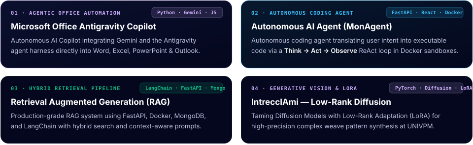
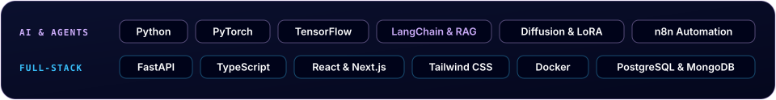

 

&nbsp;
&nbsp;
&nbsp;

### What I'm Working On

### My Work Experience

### A Small Selection of Recent Projects

<strong>Repositories:</strong>&nbsp;
<a href="https://github.com/HassenChaaben/Micosoft_office_google_antigravity_plugin">Microsoft Office Antigravity Copilot</a> ·
<a href="https://github.com/HassenChaaben/MonAgent">MonAgent (ReAct Agent)</a> ·
<a href="https://github.com/HassenChaaben/Mini_Rag_Application">Hybrid RAG Pipeline</a> ·
<a href="https://github.com/HassenChaaben/IntreccIAmi_Computer_Vision_Project">IntreccIAmi Diffusion</a> ·
<a href="https://github.com/HassenChaaben/Auction-management-backend-app">Real-Time Auction Backend</a>

### Explore My Curated Articles on AI · ML · DL

I write technical deep-dives on AI engineering, RAG systems, and agent architectures on [Medium (`@hassen.benchaaben01`)](https://medium.com/@hassen.benchaaben01) — including **[AI Periodic Table](https://medium.com/@hassen.benchaaben01/ai-periodic-table-ed1696cb7c4c)**, a visual framework organizing RAG, embeddings, and autonomous agents into structured families and periods.

<!-- MEDIUM-POSTS:START -->
| Date | Post |
| :--- | :--- |
| Jan 2026 | [AI Periodic Table](https://medium.com/@hassen.benchaaben01/ai-periodic-table-ed1696cb7c4c) |
<!-- MEDIUM-POSTS:END -->

### My Tech Stack

