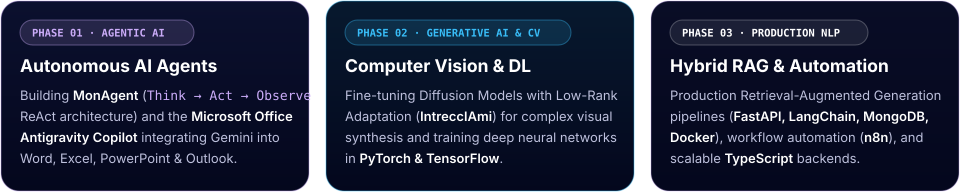
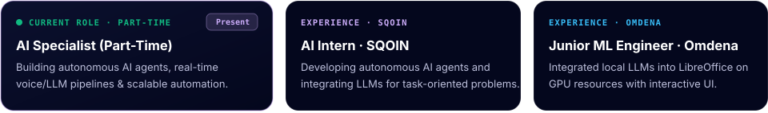

  
   
  

    &nbsp;
    &nbsp;
    &nbsp;
    
  

---

## What I'm Working On

I am a **Master's student at UNIVPM** (*Università Politecnica delle Marche*, Italy) and **Junior AI Engineer** — currently working as a **Part-Time AI Specialist** — focused on building **AI agents** and **scalable automation solutions**. My expertise lies in **Natural Language Processing**, **Computer Vision**, and **Generative AI**.

  

### My Work Experience

  

---

## Selected Projects & Curated Articles

<table>
  <tr>
    <th width="52%" align="left">A Small Selection of Recent Projects</th>
    <th width="48%" align="left">Explore My Curated Articles on AI · ML · DL</th>
  </tr>
  <tr>
    <td valign="top">
      

        <strong><a href="https://github.com/HassenChaaben/Micosoft_office_google_antigravity_plugin">Microsoft Office Antigravity Copilot</a></strong> · <code>Python</code> <code>Gemini</code> 
        Autonomous AI Copilot integrating Gemini and the Antigravity agent harness directly into Word, Excel, PowerPoint, and Outlook.
      

      

        <strong><a href="https://github.com/HassenChaaben/MonAgent">Autonomous AI Agent (MonAgent)</a></strong> · <code>FastAPI</code> <code>React</code> <code>Docker</code> 
        Autonomous coding agent translating user intent into executable code via a <em>Think → Act → Observe</em> ReAct loop inside Docker containers.
      

      

        <strong><a href="https://github.com/HassenChaaben/Mini_Rag_Application">Retrieval Augmented Generation (RAG)</a></strong> · <code>LangChain</code> <code>FastAPI</code> <code>MongoDB</code> 
        Production-grade RAG system using FastAPI, Docker, MongoDB, and LangChain with hybrid retrieval and context-aware prompts.
      

      

        <strong><a href="https://github.com/HassenChaaben/IntreccIAmi_Computer_Vision_Project">IntreccIAmi — Low-Rank Diffusion</a></strong> · <code>PyTorch</code> <code>LoRA</code> 
        Taming Diffusion Models with Low-Rank Adaptation (LoRA) for complex weave pattern synthesis.
      

      

        <strong><a href="https://github.com/HassenChaaben/Auction-management-backend-app">Multi-Strategy Real-Time Auction Backend</a></strong> · <code>TypeScript</code> <code>WebSockets</code> 
        Secure Node.js &amp; TypeScript backend for English and First-Price Sealed-Bid auctions with Sequelize ORM, PostgreSQL, WebSockets, and Docker.
      

    </td>
    <td valign="top">
      

        <strong>Featured Publication on <a href="https://medium.com/@hassen.benchaaben01">Medium</a>:</strong> 
        <a href="https://medium.com/@hassen.benchaaben01/ai-periodic-table-ed1696cb7c4c"><strong>AI Periodic Table</strong></a> — Organizes RAG, embeddings, and autonomous agents into structured families (groups) and periods (rows) to decode AI architectures, evaluate product demos, and identify missing system components.
      

<!-- MEDIUM-POSTS:START -->
| Date | Post |
| :--- | :--- |
| Jan 2026 | [AI Periodic Table](https://medium.com/@hassen.benchaaben01/ai-periodic-table-ed1696cb7c4c) |
<!-- MEDIUM-POSTS:END -->

      

        <a href="https://medium.com/@hassen.benchaaben01">Read more on @hassen.benchaaben01 →</a>
      

    </td>
  </tr>
</table>

---

## My Tech Stack

  
  
  
  
  
  
  
  
  
  
  
  
  

